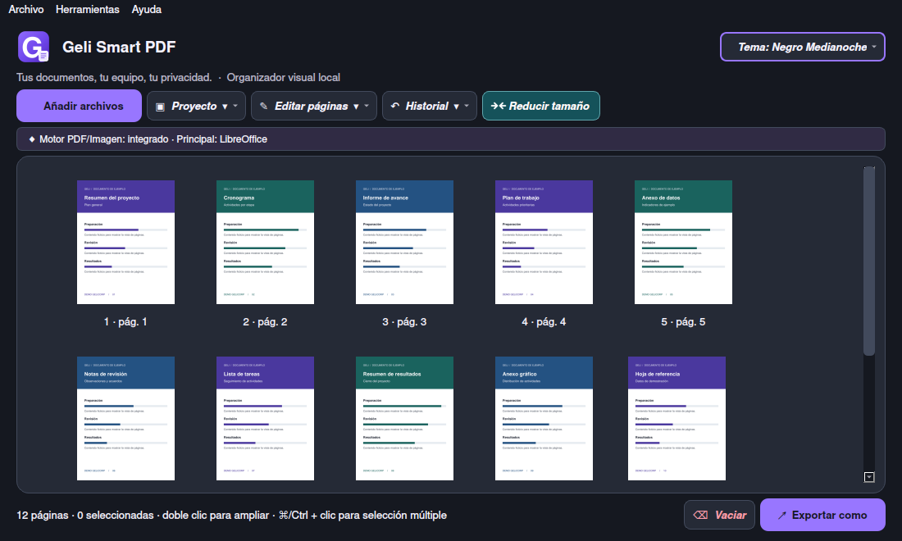

  
  <h1>Geli Smart PDF</h1>
  
<strong>Arrastra tus documentos. Ordénalos a tu manera. Exporta el resultado.</strong>

  
Une, divide y comprime PDF desde una vista de páginas, con tus archivos en tu propio equipo.

  

  
<strong>v1.0.1</strong> · Instalador de Windows x64 · 94,9 MB

  
<a href="https://github.com/GeliOSCorp/Geli-Smart-PDF/releases/download/v1.0.1/Geli-Smart-PDF-win1.0.1-portable.zip">Windows portable</a> · <a href="#macos-y-linux">macOS y Linux</a> · <a href="https://github.com/GeliOSCorp/Geli-Smart-PDF/releases">Todas las versiones</a>

  
Gratis · Procesamiento local · <a href="LICENSE">GPL-3.0</a>

  

## ¿Qué es Geli Smart PDF?

Es una app de escritorio para armar y reorganizar documentos página por página. Si tienes un informe, varios anexos y una foto que deben ir juntos, puedes arrastrarlos a la ventana, ordenar sus páginas como quieras y exportarlos como un solo PDF.

| Si necesitas… | Puedes… |
| --- | --- |
| **Juntar documentos** | Combinar PDF e imágenes y reordenar las páginas arrastrando sus miniaturas. |
| **Quedarte con algunas páginas** | Seleccionar y extraer un bloque, separar el documento por páginas o quitar las que sobran del proyecto. |
| **Corregir la orientación** | Ampliar una página con doble clic, girarla y deshacer el cambio si hace falta. |
| **Compartir un archivo más ligero** | Analizar el ahorro de tamaño, elegir un nivel de calidad y guardar una copia comprimida del PDF o de las imágenes. |
| **Exportar a imágenes** | Guardar páginas como PNG o JPG. |

Puedes guardar tu trabajo como proyecto `.gsp`, retomarlo más adelante y elegir entre cinco temas para la interfaz.

## Descargar e instalar

| Opción | Descarga | Tamaño aprox. | Requisitos |
| --- | --- | ---: | --- |
| **Windows x64 · recomendado** | [Instalador .exe](https://github.com/GeliOSCorp/Geli-Smart-PDF/releases/download/v1.0.1/Geli-Smart-PDF-Setup-win1.0.1.exe) | 94,9 MB | Incluye el entorno necesario. |
| **Windows x64 · sin instalación** | [Portable .zip](https://github.com/GeliOSCorp/Geli-Smart-PDF/releases/download/v1.0.1/Geli-Smart-PDF-win1.0.1-portable.zip) | 137,5 MB | Extrae el ZIP completo. |
| **macOS, Linux y Windows** | [Paquete Python .zip](https://github.com/GeliOSCorp/Geli-Smart-PDF/releases/download/v1.0.1/Geli-Smart-PDF-py1.0.1.zip) | 64 kB | Python 3.10–3.14. El primer inicio descarga dependencias. |

Los tamaños corresponden a las descargas de la versión 1.0.1. El paquete Python ocupa más una vez que instala sus dependencias.

### Windows

**Con instalador**

1. Descarga y abre `Geli-Smart-PDF-Setup-win1.0.1.exe`.
2. Elige el idioma del asistente y sigue los pasos de instalación.
3. Busca **Geli Smart PDF** en el menú Inicio.

**Con el portable** · Haz clic derecho en el ZIP, selecciona **Extraer todo** y abre `Geli-Smart-PDF.exe` dentro de la carpeta extraída. Conserva el ejecutable junto a las carpetas que vienen en el ZIP.

### macOS y Linux

1. Descarga y extrae el [paquete Python](https://github.com/GeliOSCorp/Geli-Smart-PDF/releases/download/v1.0.1/Geli-Smart-PDF-py1.0.1.zip).
2. Comprueba que tienes Python 3.10–3.14 y abre la terminal en la carpeta extraída.
3. Ejecuta el lanzador de tu sistema.

| Sistema | Comando |
| --- | --- |
| macOS | `bash iniciar_mac.command` |
| Linux | `bash iniciar_linux.sh` |

En Windows también puedes usar el paquete Python con `iniciar_windows.bat`.

## Tu primer PDF

1. **Añade archivos.** Arrástralos a la ventana o pulsa **Añadir archivos**.
2. **Prepara las páginas.** Muévelas para cambiar el orden. Desde **Editar páginas** puedes girar, extraer o quitar las que selecciones.
3. **Guarda el resultado.** En **Exportar como**, elige PDF, PNG o JPG. Si necesitas reducir el peso de un archivo, abre **Reducir tamaño** y revisa el ahorro antes de guardar.

## Preguntas frecuentes

**¿Tengo que subir mis documentos a Internet?**  
Los PDF y las imágenes se procesan en tu equipo. El paquete Python necesita conexión para preparar las dependencias al inicio. También se usa conexión si consultas o instalas actualizaciones del motor.

**¿Puedo añadir Word o PowerPoint?**  
Sí, si tienes una suite compatible instalada. Geli puede usar Word o PowerPoint en Windows, Pages o Keynote en macOS, o LibreOffice como alternativa. En Linux la conversión usa LibreOffice. Puedes incluir las páginas resultantes en tu PDF o exportarlas como imágenes.

**¿Por qué mi PDF casi no redujo de tamaño?**  
Un PDF que ya fue optimizado puede ahorrar muy poco con el mismo nivel de calidad. El análisis muestra el tamaño estimado antes de que guardes la copia.

**¿Qué guarda un proyecto `.gsp`?**  
Guarda el orden de las páginas y las referencias a los archivos. Mantén los archivos de origen en sus rutas para poder abrir el proyecto otra vez.

## Código y licencia

El código de la aplicación, sus lanzadores y las dependencias declaradas están en el [paquete Python](https://github.com/GeliOSCorp/Geli-Smart-PDF/releases/download/v1.0.1/Geli-Smart-PDF-py1.0.1.zip). Consulta la [licencia GPL-3.0](LICENSE) y los [avisos del proyecto](NOTICE).

[Ver las versiones](https://github.com/GeliOSCorp/Geli-Smart-PDF/releases) · [Reportar un problema](https://github.com/GeliOSCorp/Geli-Smart-PDF/issues/new)
